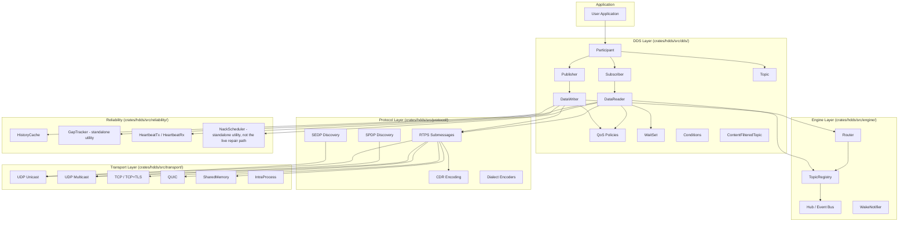
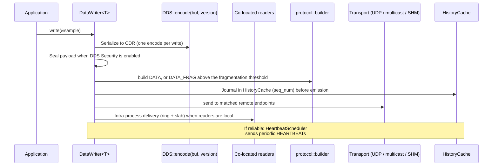
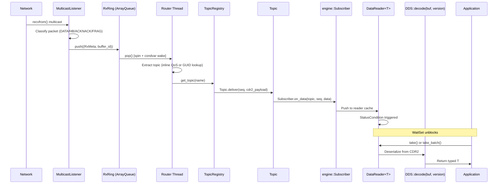
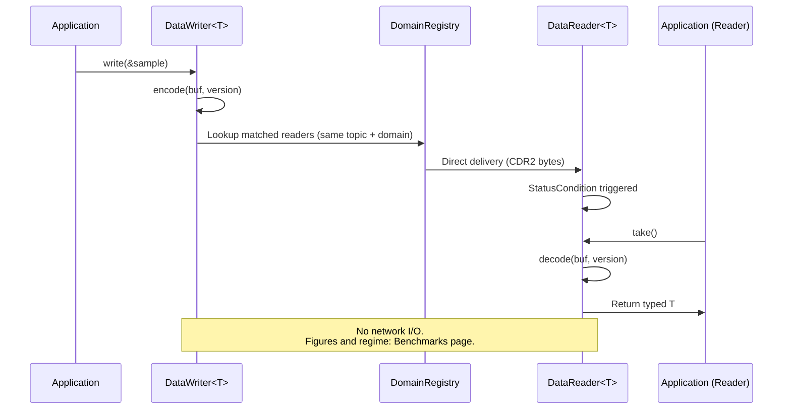
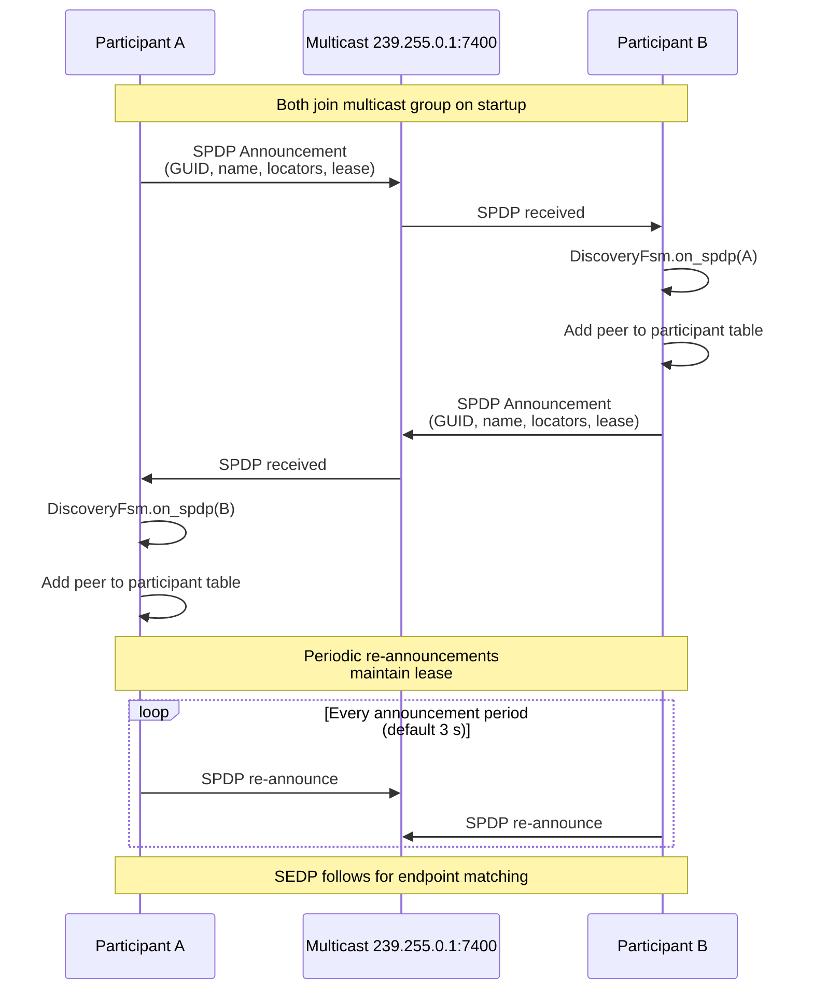
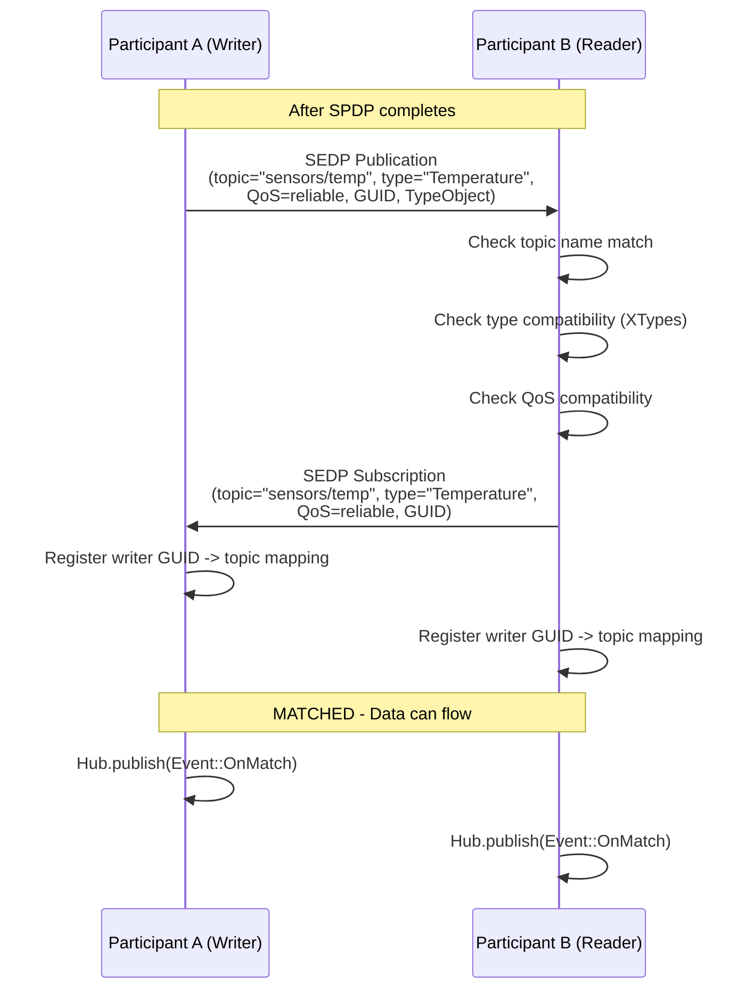

# HDDS Internal Architecture

This document describes the internal architecture of HDDS (High-performance Data Distribution Service), a pure Rust implementation of the OMG DDS and RTPS specifications (announced as RTPS 2.4 on the wire).

---

## 1. High-Level Architecture

HDDS is organized as a layered stack. Each layer depends only on the layers below it.

```
+-----------------------------------------------------------------------+
|                          Application Layer                            |
|   Participant::builder() -> topic::<T>() -> writer() / reader()       |
+-----------------------------------------------------------------------+
|                            DDS Layer                                  |
|   QoS Policies | Topic Management | WaitSet | Conditions | Listeners |
+-----------------------------------------------------------------------+
|                           Engine Layer                                |
|   Router | TopicRegistry | Hub (Event Bus) | WakeNotifier            |
+-----------------------------------------------------------------------+
|                          Protocol Layer                               |
|   RTPS Submessages | CDR Encoding | Discovery (SPDP/SEDP) | Dialects|
+-----------------------------------------------------------------------+
|                        Reliability Layer                              |
|   HistoryCache | GapTracker/NackScheduler (utilities) | HeartbeatTx/Rx|
+-----------------------------------------------------------------------+
|                     Congestion Control Layer (not wired)              |
|   TokenBucket | WriterPacer | WFQ | BudgetAllocator | RateController |
+-----------------------------------------------------------------------+
|                        Transport Layer                                |
|   UDP | Multicast | TCP | TCP+TLS | QUIC | SharedMemory | IntraProcess|
+-----------------------------------------------------------------------+
```



---

## 2. Crate Structure

The workspace contains the following crates, each with a specific responsibility:

| Crate | Path | Purpose |
|-------|------|---------|
| `hdds` | `crates/hdds/` | Core DDS/RTPS implementation (the main library) |
| `hdds-c` | `crates/hdds-c/` | C FFI bindings exposing HDDS to C/C++/Python |
| `hdds-codegen` | `crates/hdds-codegen/` | Proc-macro crate for `#[derive(DDS)]` |
| `rmw-hdds` | `crates/rmw-hdds/` | ROS 2 RMW integration layer |
| `hdds-discovery-server` | `crates/hdds-discovery-server/` | Standalone discovery registry and relay binary |
| `hdds-persistence` | `crates/hdds-persistence/` | Persistence service for TRANSIENT/PERSISTENT durability (SQLite/RocksDB) |
| `hdds-recording` | `crates/hdds-recording/` | Topic recording and replay |
| `hdds-gateway` | `crates/hdds-gateway/` | REST API gateway with web UI |
| `hdds-router` | `crates/hdds-router/` | Routing service: domain bridging and topic transformation |
| `hdds-logger` | `crates/hdds-logger/` | Distributed logging service aggregating logs from DDS participants |
| `hdds-micro` | `crates/hdds-micro/` | Embedded DDS for microcontrollers |
| `hdds-micro-c` | `crates/hdds-micro-c/` | C bindings for hdds-micro |
| `hdds-telemetry-otlp` | `crates/hdds-telemetry-otlp/` | OpenTelemetry OTLP exporter |
| `hdds-micro-sel4` | `crates/hdds-micro-sel4/` | seL4/Microkit transport adapter for hdds-micro |
| `hdds-xrce` | `crates/hdds-xrce/` | DDS-XRCE agent/client bridge for resource-constrained devices |
| `hdds-xrce-client` | `crates/hdds-xrce-client/` | `no_std` DDS-XRCE client for microcontrollers |
| `hdds-wasm` | `crates/hdds-wasm/` | WebAssembly DDS client with relay bridge |
| `hdds-influx-sink` | `crates/hdds-influx-sink/` | InfluxDB sink for DDS topics |
| `hdds-schema-registry` | `crates/hdds-schema-registry/` | Schema registry for DDS types |

The IDL code generator is `hddsgen`, which lives in its own repository
(`hdds_gen`) and is installed separately; see the README.

### Tools (`tools/`)

| Tool | Purpose |
|------|---------|
| `hdds-gen` | QoS validator generator (`hdds-gen qos-validator`); not the IDL compiler |
| `hddsctl` | CLI metrics viewer (reads the participant telemetry stream over TCP) |
| `hdds-admin` | Admin operations (mesh introspection, snapshots) |
| `hdds-convert-qos` | Multi-vendor QoS converter (validate, convert, normalize) |
| `hdds-debugger` | Web-based debugging UI |
| `hdds-ws` | WebSocket bridge for browser clients |
| `hdds-topic-echo` | Topic monitoring (like `ros2 topic echo`) |
| `hdds-latency-probe` | Latency measurement tool |
| `hdds-stress` | Load/stress testing tool |
| `hdds-discovery-dump` | Discovery packet inspector |
| `hdds-shm-viewer` | Shared memory segment inspector |

---

## 3. Core Modules

### 3.1 `dds/` -- DDS API Layer

**Path:** `crates/hdds/src/dds/`

The user-facing DDS API following the OMG DDS 1.4 specification.

| Module | Type | Description |
|--------|------|-------------|
| `participant/` | `Participant` | Entry point. Factory for all DDS entities. Owns transport, discovery, and router. |
| `participant/builder.rs` | `ParticipantBuilder` | Builder pattern for participant configuration. |
| `participant/runtime.rs` | `Participant` (struct) | Runtime state: GUID, transport, registry, discovery FSM, threads. |
| `writer/` | `DataWriter<T>` | Typed publisher. Serializes via `DDS` trait, sends via transport. |
| `writer/heartbeat_scheduler.rs` | `HeartbeatSchedulerHandle` | Periodic HEARTBEAT sending for reliable writers. |
| `writer/nack.rs` | NACK handling | Processes ACKNACK from readers, triggers retransmission. |
| `reader/` | `DataReader<T>` | Typed subscriber. Receives CDR2 data, deserializes via `DDS` trait. |
| `reader/cache.rs` | Sample cache | Local sample storage with history depth. |
| `reader/heartbeat.rs` | HEARTBEAT processing | Gap detection and NACK scheduling on heartbeat. |
| `reader/subscriber.rs` | Engine subscriber | Implements `engine::Subscriber` trait for data delivery. |
| `publisher.rs` | `Publisher` | Grouping entity for writers (QoS propagation). |
| `subscriber.rs` | `Subscriber` | Grouping entity for readers (QoS propagation). |
| `topic.rs` | `Topic` | Named, typed data channel; factory of reader and writer builders. |
| `waitset.rs` | `WaitSet` | Blocks until conditions trigger. |
| `condition/` | `GuardCondition`, `StatusCondition` | Trigger mechanisms for WaitSet. |
| `read_condition/` | `ReadCondition`, `QueryCondition` | Content-aware triggering. |
| `content_filtered_topic.rs` | `ContentFilteredTopic` | SQL-like filter on incoming samples. |
| `filter/` | `ContentFilter`, `FilterEvaluator` | SQL filter expression parser and runtime evaluator. |
| `listener.rs` | Listener traits | Callback-based notifications (`DataReaderListener`, `DataWriterListener`). |
| `domain_registry.rs` | `DomainRegistry`, `DomainState` | Intra-process endpoint matching and auto-binding. |
| `qos/` | QoS policies | All QoS policy definitions (`Reliability`, `Durability`, `Deadline`, etc.). |

**Entity hierarchy:**

```
DomainParticipant
 +-- Publisher
 |    +-- DataWriter<T>  ------> Topic<T>
 +-- Subscriber
      +-- DataReader<T>  <------ Topic<T>
```

### 3.2 `engine/` -- Message Routing Engine

**Path:** `crates/hdds/src/engine/`

The central data routing engine. Receives raw RTPS packets from transports and delivers them to the correct subscribers.

| Module | Type | Description |
|--------|------|-------------|
| `router.rs` | `Router` | Background thread that pops packets from `RxRing` (lock-free ArrayQueue) and routes them via `TopicRegistry`. Handles DATA, DATA_FRAG, HEARTBEAT, ACKNACK, HEARTBEAT_FRAG. |
| `router.rs` | `RouterMetrics` | Lock-free atomic counters: `packets_routed`, `packets_orphaned`, `delivery_errors`, `bytes_delivered`, `nack_frag_requests`, `fragment_timeouts`, `packets_deduplicated`. |
| `router.rs` | `route_data_packet()` | **HOT PATH** function. Attempts inline QoS topic extraction first, falls back to GUID-based routing (SEDP mapping) for cross-vendor interop. |
| `demux.rs` | `TopicRegistry` | Thread-safe (RwLock) topic-to-subscribers mapping. Also maintains `writer_guid_to_topic` map for GUID-based routing. |
| `demux.rs` | `Topic` | Topic metadata + subscriber list with panic-isolated delivery. |
| `hub.rs` | `Hub` | Event bus: MPSC producer to NxSPSC subscriber rings. Broadcasts `Event::OnMatch`, `OnUnmatch`, `OnIncompatibleQos`, `SystemStall`. |
| `subscriber.rs` | `Subscriber` trait, `CallbackSubscriber` | Callback pattern for receiving topic data from the router. |
| `unicast_router.rs` | `route_raw_rtps_message()` | Routes raw RTPS messages arriving via TCP/QUIC unicast connections. |
| `wake.rs` | `WakeNotifier` | Notification that wakes a parked router thread when a packet arrives. |

**Data flow through the engine:**

```
MulticastListener -> RxRing.push()
      |
      v
Router.pop() -> parse topic name / GUID
      |
      v
TopicRegistry.get_topic()
      |
      v
Topic.deliver() -> Subscriber.on_data()
      |
      v
Hub.publish(Event) -> NxSPSC rings
```

### 3.3 `protocol/` -- RTPS Wire Protocol

**Path:** `crates/hdds/src/protocol/`

Implementation of the RTPS wire protocol (announced as protocol version 2.4).

| Module | Description |
|--------|-------------|
| `constants.rs` | RTPS PIDs, entity IDs, vendor IDs, protocol version bytes. |
| `rtps/` | **Vendor-neutral** RTPS submessage encoders. |
| `rtps/data.rs` | `encode_data()`, `encode_data_frag()` -- DATA (0x15) and DATA_FRAG (0x16). |
| `rtps/acknack.rs` | `encode_acknack()` -- ACKNACK (0x06) positive/negative acknowledgment. |
| `rtps/heartbeat.rs` | `encode_heartbeat()` -- HEARTBEAT (0x07) writer liveness. |
| `rtps/gap.rs` | `encode_gap()` -- GAP (0x08) irrelevant sequences. |
| `rtps/info.rs` | `encode_info_dst()`, `encode_info_ts()` -- INFO_DST (0x0E), INFO_TS (0x09). |
| `rtps/locator.rs` | Locator encoding for unicast/multicast addresses. |
| `builder/` | High-level packet construction and extraction (`packet.rs`, `extract.rs`, ACKNACK, NACK_FRAG and HEARTBEAT_FRAG builders). |
| `builder/nack_frag.rs` | NACK_FRAG packet builder for fragment repair requests. |
| `builder/heartbeat_frag.rs` | HEARTBEAT_FRAG packet builder. |
| `discovery/` | SPDP and SEDP protocol parsers and builders. |
| `discovery/spdp/` | Simple Participant Discovery Protocol -- build and parse SPDP announcements. |
| `discovery/sedp/` | Simple Endpoint Discovery Protocol -- build and parse endpoint publications/subscriptions. |
| `dialect/` | Vendor-specific encoding overrides for multi-vendor interoperability. |

**Vendor dialects (`protocol/dialect/`):**

| Dialect | Module |
|---------|--------|
| Fast DDS | `dialect/fastdds/` |
| RTI Connext | `dialect/rti/` |
| Cyclone DDS | `dialect/cyclone/` |
| OpenDDS | `dialect/opendds/` |
| HDDS native | `dialect/hdds/` |
| OpenSplice | `dialect/opensplice/` |
| CoreDX | `dialect/coredx/` |
| Gurum | `dialect/gurum/` |
| InterCOM | `dialect/intercom/` |
| Dust | `dialect/dust/` |
| Hybrid (conservative fallback for any spec-compliant peer) | `dialect/hybrid/` |

The OpenSplice, CoreDX, Gurum, InterCOM and Dust dialects are compiled in
with the matching `dialect-*` Cargo features. The interoperability runs
published with the project are listed in [Interoperability](interop/index.md).

**Architectural constraint:**

```
ALLOWED:   dialect::* -> protocol::rtps::*
FORBIDDEN: protocol::rtps -> dialect::*
```

**Runtime invariant -- vendor resolution doctrine:**

Vendor-specific behavior is a COLD-PATH concern. The founding rule:

1. Resolve the peer vendor ONCE, at pairing time (SPDP/SEDP discovery),
   from the RTPS header vendorId or PID_VENDOR_ID.
2. Persist the decision as a per-peer flag (participant/endpoint record).
3. The data hot path reads that flag in O(1). It NEVER re-derives the
   vendor per message: no `if vendorId == X` in per-sample code.
4. HDDS <-> HDDS is the reference path: it must never traverse a vendor
   branch. Cross-vendor accommodations are quarantined behind the
   per-peer flag so the self path stays byte-clean and certifiable.

Structural accommodations (e.g., accepting a wire pattern only one vendor
emits, without checking who sent it) are acceptable when the pattern is
unambiguous -- they are implicitly vendor-scoped and add no branch for
conforming peers. Prefer them over vendorId checks in shared code.

Any deviation (a vendor check on the per-message path) requires explicit
maintainer sign-off and an entry in the exceptions list below, with the
refactor path noted. Known exceptions:

| Site | Deviation | Status |
|------|-----------|--------|
| `engine/router.rs` (`route_writer_vendor` thread-local) | Reads RTPS header vendorId per routed datagram to steer coherent-set commit semantics per writer vendor | Accepted |
| `engine/router.rs` (StatusInfo byte-order fold) | Accepts a little-endian StatusInfo from a peer (the spec defines it as a big-endian octet array) on the general delivery path | Accepted: structural, no vendorId branch; conforming encodings unaffected |

### 3.4 `transport/` -- Transport Layer

**Path:** `crates/hdds/src/transport/`

Network transports for RTPS communication.

| Module | Type | Description |
|--------|------|-------------|
| `udp.rs` | `UdpTransport` | UDP unicast socket management, `send()`, `send_to_endpoint()`. |
| `multicast.rs` | Multicast | Multicast group joining, interface discovery, multicast listener threads. |
| `ports.rs` | `PortMapping` | RTPS v2.5 port number calculation (domain_id + participant_id -> ports). |
| `tcp/` | `TcpTransport` | Manual HDDS-to-HDDS TCP endpoint and inbound RTPS routing; DDS writers remain UDP-backed. |
| `tcp/tls.rs` | TLS | TCP+TLS via rustls (ServerConnection/ClientConnection). |
| `tcp/io_thread.rs` | I/O thread | mio event loop for non-blocking TCP/TLS I/O. |
| `tcp/connection_manager.rs` | Connection manager | Tracks pending/active connections, GUID extraction from RTPS headers. |
| `quic/` | `QuicTransport` | Manual QUIC handle and inbound RTPS routing (feature-gated); DDS writers do not select it. |
| `quic/io_thread.rs` | Sync wrapper | Background thread with mini tokio runtime for sync API access. |
| `shm/` | `ShmSegment`, `ShmRingWriter`, `ShmRingReader` | Linux shared memory transport. Lock-free ring buffer with futex notifications, between processes on the same host. |
| `shm/policy.rs` | `ShmPolicy` | Transport selection: `Prefer` / `Require` / `Disable`. |
| `tsn/` | `TsnConfig` | Time-Sensitive Networking for deterministic Ethernet (SO_TXTIME). |
| `lowbw/` | `LowBwConfig`, `LowBwTransport` | Low bandwidth transport for constrained links (LoRa, satellite), with optional LZ4 compression. A separate API driven by the application (`send` / `poll_recv`); `DataWriter::write` does not use it, and its session handshake (HELLO/MAP/ACK) is implemented and tested on its own but never started by `LowBwTransport`. |
| `mobility/` | IP mobility | Application-driven network handover detection and locator tracking helpers. |
| `dscp.rs` | `DscpConfig` | Differentiated Services Code Point for traffic classification. |
| `filter.rs` | `NetworkFilter` | Source/interface filter types. Source filtering is not applied: setting `HDDS_SOURCE_ALLOW`/`HDDS_SOURCE_DENY` fails participant creation. |
| `ttl.rs` | `TtlConfig` | IP Time-To-Live configuration. |

### 3.5 `discovery/` -- Discovery Mechanisms

**Path:** `crates/hdds/src/discovery/`

Higher-level discovery backends beyond the built-in SPDP/SEDP.

| Module | Description |
|--------|-------------|
| `cloud/aws.rs` | AWS Cloud Map service discovery. |
| `cloud/azure.rs` | Azure Service Discovery. |
| `cloud/consul.rs` | HashiCorp Consul service discovery. |
| `cloud/poller_thread.rs` | Sync wrapper: background thread with mini tokio runtime. Auto-started via `.with_consul()`. |
| `k8s.rs` | Kubernetes DNS-based discovery (Headless Services). Zero external dependencies. |

The core SPDP/SEDP implementation lives in `crates/hdds/src/core/discovery/` (the `core` module), not in `discovery/`.

### 3.6 `reliability/` -- Reliable Protocol

**Path:** `crates/hdds/src/reliability/`

RTPS reliability protocol implementation (RTPS v2.5 Section 8.4).

| Module | Type | Description |
|--------|------|-------------|
| `history_cache.rs` | `HistoryCache` | Writer-side sample storage for retransmission. Bounded by `KEEP_LAST(depth)`. |
| `gap_tracker.rs` | `GapTracker` | Standalone sequence-number gap detection utility (used by `NackScheduler` and `examples/reliable_demo.rs`); not wired to a live DataReader. |
| `messages.rs` | `HeartbeatMsg`, `NackMsg`, `GapMsg`, `InfoDstMsg`, `InfoTsMsg` | RTPS reliability message types with serialization. |
| `rtps_range.rs` | `RtpsRange` | Sequence number range operations (bitmap-based). |
| `seq.rs` | `SeqNumGenerator` | Monotonic sequence number generator. |
| `writer.rs` | `HeartbeatTx`, `GapTx`, `WriterRetransmitHandler` | Writer-side reliability: periodic heartbeats, gap announcements, retransmission on NACK. |
| `reader.rs` | `HeartbeatRx`, `NackScheduler`, `ReaderRetransmitHandler` | `HeartbeatRx` derives missing ranges and feeds the fallback ACKNACK path (`dds::reader::heartbeat`, no `control_tx`); `NackScheduler`/`ReaderRetransmitHandler` are standalone bookkeeping utilities, not wired to a live DataReader. The production repair path is the per-writer `ReaderProxyRegistry` (`core/reader/`) plus the control-plane ACKNACK. |
| `metrics.rs` | `ReliableMetrics` | Counters: heartbeats sent, NACKs sent, retransmits, gaps detected, out-of-order. |

**Reliable delivery flow:**

```
Writer                                    Reader
  |                                          |
  |--- DATA (seq=1) ------------------------>|
  |--- DATA (seq=2) ----------X (lost)       |
  |--- DATA (seq=3) ------------------------>|
  |                                          |
  |--- HEARTBEAT (first=1, last=3) -------->|
  |                                          | (detects gap: seq=2 missing)
  |<-- ACKNACK (missing: [2]) --------------|
  |                                          |
  |--- DATA (seq=2) [retransmit] ---------->|
  |                                          | (gap filled)
```

### 3.7 `security/` -- DDS Security

**Path:** `crates/hdds/src/security/`

DDS Security v1.1 plugin architecture (feature-gated: `security`).

| Module | Type | Description |
|--------|------|-------------|
| `mod.rs` | `SecurityPluginSuite` | Holds the 4 plugins plus the runtime state (`HandshakeMachine`, `DataKeyStore`). Attached to `Participant` at creation. |
| `config.rs` | `SecurityConfig`, `SecurityConfigBuilder` | Builder for security configuration (certs, keys, permissions). |
| `authentication.rs` | `AuthenticationPlugin` trait | X.509 certificate-based identity verification. |
| `authentication/x509/` | X.509 parsing | Certificate chain validation. |
| `handshake/` | `HandshakeMachine` | PKI-DH 3-message handshake state machine; fail-closed key-agreement suite policy; per-peer keys live in its `Complete` state. |
| `access/mod.rs` | `AccessControlPlugin` | Governance + permissions enforcement (local create checks). |
| `access/permissions.rs` | Permissions | XML-based topic/partition access rules. |
| `access/rules.rs` | Rules engine | Deny-by-default rule evaluation. |
| `crypto/mod.rs` | `CryptoPlugin` | Encryption-requested marker (fieldless); its presence switches the data plane on. |
| `crypto/aes_gcm.rs` | AES-256-GCM | Cipher (encrypt/decrypt with AAD). |
| `crypto/key_exchange.rs` | ECDH | P-256 / P-384 key agreement for the handshake. |
| `crypto/session_keys.rs` | Key derivation | Static HKDF helpers (no stored state). |
| `crypto/user_data.rs` | Data-plane sealer | DDS-Security CryptoHeader / CryptoContent / CryptoFooter for complete user and lifecycle SerializedPayloads. |
| `crypto/data_keys.rs` | `DataKeyStore` | Per-writer data-plane keys, local and remote, keyed `(writer GUID, key id)`. |
| `crypto/peer_keys.rs` | `PeerKeys` | Per-peer metatraffic + key-wrap keys derived from the MasterSharedSecret. |
| `crypto/volatile.rs` | `WriterKeyAnnouncement` | Key distribution over ParticipantVolatileMessageSecure, sealed per peer. |
| `crypto/secure_sedp.rs` | Secure SEDP tunnel | Per-peer metatraffic sealing of SEDP / ParticipantMessage payloads. |
| `crypto/secure_submessage.rs` | Secure submessage codec | SEC_PREFIX / SEC_BODY / SEC_POSTFIX and shared session-key / IV primitives. |
| `audit/` | `LoggingPlugin`, `AuditChain` | Hash-chained audit trail. |

**Plugin architecture:**

```
SecurityPluginSuite
 +-- AuthenticationPlugin  (X.509 certificate validation)
 +-- AccessControlPlugin   (Permissions XML enforcement)
 +-- CryptoPlugin          (encryption marker; sealing lives in crypto::user_data)
 +-- LoggingPlugin         (Audit trail + hash-chain)
 +-- HandshakeMachine      (PKI-DH state + per-peer keys)
 +-- DataKeyStore          (per-writer data-plane keys)
```

### 3.8 `xtypes/` -- Type System

**Path:** `crates/hdds/src/xtypes/`

XTypes v1.3 support for runtime type discovery and compatibility checking.

| Module | Description |
|--------|-------------|
| `type_id.rs` | `TypeIdentifier` -- Type identification (TK_FLOAT32, TK_INT32, etc.). |
| `type_kind.rs` | `TypeKind` -- Classification of types. |
| `equivalence.rs` | Type compatibility checking (structural equivalence). |
| `type_object/` | `CompleteTypeObject` -- Full type definition for SEDP announcements. |
| `cdr2/` | CDR2 encoding for all XTypes types (primitives, strings, collections, structs, unions, enums, bitsets, aliases, annotations). |
| `builder/` | Type builders including `rosidl_message_type_support_t` for ROS 2 integration. |

### 3.9 `congestion/` -- Congestion Control

**Path:** `crates/hdds/src/congestion/`

Adaptive congestion control building blocks.

**Status: not wired.** Nothing outside `crates/hdds/src/congestion/` calls this
module: `DataWriter::write` does not pass through `WriterPacer`, a token bucket
or the `CongestionController`, and no reader or transport feeds it RTT or loss
signals. It is public library code with its own unit tests, available to an
embedder that builds its own pacing loop.

| Module | Type | Description |
|--------|------|-------------|
| `controller.rs` | `CongestionController` | Central orchestrator: scorer + rate controller + budget allocator. |
| `token_bucket.rs` | `TokenBucket` | Per-writer token bucket rate limiter. |
| `writer_pacer.rs` | `WriterPacer` | Priority queues (P0/P1/P2) with token-bucket gating. |
| `rate_controller.rs` | `RateController` | AIMD (Additive Increase / Multiplicative Decrease) rate adaptation. |
| `rtt_estimator.rs` | `RttEstimator` | Round-trip time estimation (EWMA). |
| `scorer.rs` | `CongestionScorer` | Congestion state scoring (EWMA-based). |
| `budget_allocator.rs` | `BudgetAllocator` | Per-writer budget allocation with P0 reserve. |
| `coalescing.rs` | `CoalescingQueue` | P2 "last value wins" coalescing by instance key. |
| `nack_coalescer.rs` | `NackCoalescer` | NACK batching to reduce repair storms. |
| `repair_queue.rs` | `RepairQueue` | Repair scheduling with budget limiting. |
| `retry_tracker.rs` | `RetryTracker` | Exponential backoff retry logic. |
| `wfq.rs` | `WfqScheduler`, `PriorityWfqScheduler` | Weighted Fair Queuing for multi-writer scheduling. |
| `ecn.rs` | `EcnProcessor` | Explicit Congestion Notification support. |
| `transport_feedback.rs` | `TransportFeedback` | Network signal classification (EAGAIN, timeouts). |

**Priority semantics:**

- **P0 (Critical):** Never dropped, can bypass rate limit.
- **P1 (Normal):** Drops oldest when queue full.
- **P2 (Background):** Coalesced by instance key, "last value wins".

---

## 4. Data Flow

### 4.1 Write Path (Publisher to Network)

The write path runs on the calling thread. There is no pacer or congestion
controller on it (see section 3.9: the congestion module is not wired); the
send is synchronous and bounded only by the socket and the writer's QoS.



### 4.2 Read Path (Network to Subscriber)



### 4.3 Intra-Process Path

When both writer and reader are in the same process with `TransportMode::IntraProcess`:



> **Latency scope.** Write, read, roundtrip, and end-to-end delivery are distinct
> metrics. The figure above measures one sequential `write(16-byte POD) -> take()`
> per iteration on the benchmark host (Intel i9-9900KF), default build of the
> 1.5.0 release: p50 180 ns, p99 190 ns, 5.05 M delivered messages/s. It is
> single-threaded, intra-process, best-effort `KeepLast(1)`, not a generic DDS or
> network latency. See [Benchmarks](guides/performance/benchmarks.md) for the
> exact regime, the reproducer, and the cross-thread figures.

---

## 5. Thread Model

HDDS spawns several background threads depending on configuration. All threads are cleanly joined on `Participant::drop()`.

| Thread | Spawned By | Purpose | Lifetime |
|--------|-----------|---------|----------|
| **Router** | `Participant::build()` | Pops packets from `RxRing`, routes via `TopicRegistry` | Participant lifetime |
| **MulticastListener** (N) | `Participant::build()` | One per multicast/unicast socket. `recvfrom()` loop, pushes to `RxRing` | Participant lifetime |
| **SPDP Announcer** | `Participant::build()` | Periodic SPDP announcement broadcast | Participant lifetime |
| **Lease Tracker** | `Participant::build()` | Monitors participant leases, removes expired peers | Participant lifetime |
| **Control Handler** | `Participant::build()` | Two-Ring HEARTBEAT/ACKNACK processing | Participant lifetime |
| **Heartbeat Scheduler** | `DataWriter::new()` | Sends periodic HEARTBEATs for reliable writers | Writer lifetime |
| **Telemetry Collector** | `Participant::build()` | Metrics aggregation and export | Participant lifetime |
| **TCP I/O Thread** | `Participant::build()` (if TCP) | mio event loop for TCP/TLS connections | Participant lifetime |
| **QUIC I/O Thread** | `Participant::build()` (if QUIC) | Mini tokio runtime for quinn QUIC connections | Participant lifetime |
| **Cloud Discovery Poller** | `Participant::build()` (if cloud) | Mini tokio runtime for Consul/AWS/Azure polling | Participant lifetime |
| **K8s DNS Poller** | `Participant::build()` (if k8s) | DNS SRV query loop for Kubernetes discovery | Participant lifetime |
| **Unicast Routing Thread** | `Participant::build()` (if TCP/QUIC) | Routes TCP/QUIC incoming messages to TopicRegistry | Participant lifetime |

**Router thread wake strategy:**

```
1. Fast path: immediate ring.pop()
2. Spin phase: spin for a wall-time budget (HDDS_ROUTER_SPIN_US: learned per
   thread by default, a whole number of microseconds for a fixed budget,
   0 for no spin)
3. Park phase: WakeNotifier wait (10 ms timeout), woken as soon as a packet arrives
```

Wake latency depends on scheduler state, core placement, load, and machine; the
current certificate does not measure this component independently.

---

## 6. Discovery

### 6.1 SPDP (Simple Participant Discovery Protocol)



### 6.2 SEDP (Simple Endpoint Discovery Protocol)



---

## 7. Configuration

HDDS supports configuration via:

1. **Builder API** -- `Participant::builder("name").domain_id(0).build()`
2. **Environment variables** -- for example `HDDS_DOMAIN_ID` (used when the builder sets no domain), `HDDS_INTERFACE`, `HDDS_SPDP_UNICAST_PEERS`; the full list is in the [environment variable reference](reference/environment-vars.md)
3. **XML/YAML QoS files** -- Loaded via `qos-loaders` feature (`QoS::load_fastdds`, `QoS::from_xml`, YAML profiles)

### Feature Flags

Default features: `xtypes`, `qos-loaders`, `xtypes-structural-assignability`.
Everything else is opt-in.

| Feature | Default | Description |
|---------|---------|-------------|
| `xtypes` | yes | XTypes v1.3 type discovery |
| `xtypes-structural-assignability` | yes | Structural assignability for nested complex type references |
| `qos-loaders` | yes | XML/YAML QoS file loading |
| `type-lookup` | no | Auto type lookup during discovery |
| `security` | no | DDS Security v1.1 |
| `quic` | no | Manual QUIC endpoint/handle and inbound routing |
| `tcp-tls` | no | TLS for the manual TCP endpoint |
| `k8s` | no | Kubernetes DNS discovery |
| `cloud-discovery` | no | AWS/Azure/Consul discovery |
| `rpc` | no | DDS-RPC request/reply |
| `lowbw-lz4` | no | LZ4 compression for low bandwidth |
| `dynamic-types` | no | Runtime type manipulation |
