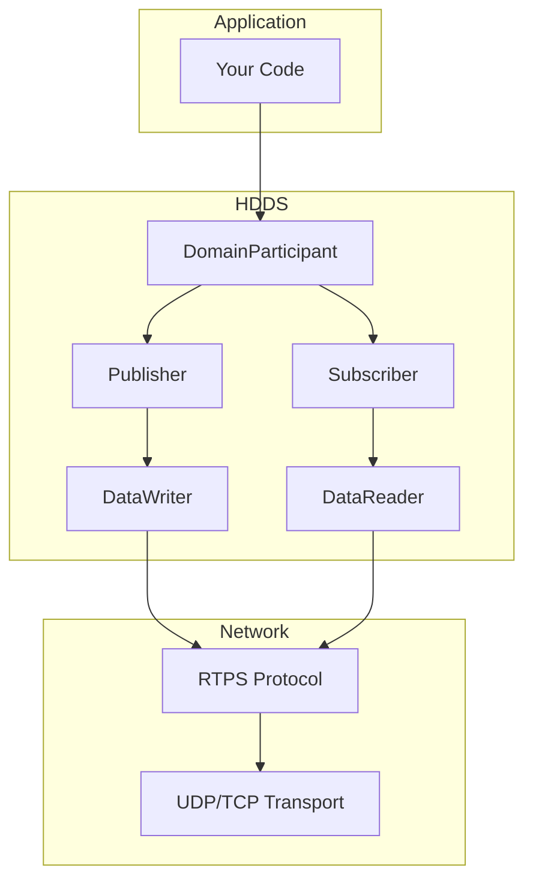

# Getting Started with HDDS

Welcome to HDDS, a high-performance DDS (Data Distribution Service) middleware written in pure Rust. This guide will help you get started quickly.

## Quick Start

import Tabs from '@theme/Tabs';
import TabItem from '@theme/TabItem';

<Tabs>
  <TabItem value="rust" label="Rust" default>

HDDS is used from a clone of this repository (the versions on crates.io may lag
it); see [Installation](installation/linux.md). In your project's `Cargo.toml`:

```toml
[dependencies]
hdds = { path = "/path/to/hdds/crates/hdds" }
```

```rust
use hdds::{Participant, QoS, Result, TransportMode, DDS};

#[derive(Debug, Clone, DDS)]
struct Temperature {
    #[key]
    sensor_id: String,
    value: f32,
    timestamp: u64,
}

fn main() -> Result<()> {
    // Create a participant on domain 0
    let participant = Participant::builder("my_app")
        .domain_id(0)
        .with_transport(TransportMode::UdpMulticast)
        .build()?;

    // Create a writer for a topic and publish a sample
    let writer = participant
        .topic::<Temperature>("sensor/temp")?
        .writer()
        .qos(QoS::reliable())
        .build()?;
    writer.write(&Temperature {
        sensor_id: "room1".into(),
        value: 23.5,
        timestamp: 0,
    })?;

    Ok(())
}
```

  </TabItem>
  <TabItem value="c" label="C">

Build the C library from a clone of the repository with `make sdk-c` (see
[Build from source](installation/from-source.md#build-cc-sdks)); the header is
`sdk/c/include/hdds.h` and the library `target/release/libhdds_c.so`.

```c
#include <stdint.h>
#include "hdds.h"
#include "Temperature.h"   /* hddsgen gen c temperature.idl -o Temperature.h */

int main(void) {
    struct HddsParticipant *participant = hdds_participant_create("my_app");
    if (participant == NULL) { return 1; }

    struct HddsDataWriter *writer = hdds_writer_create(participant, "sensor/temp");
    if (writer == NULL) { hdds_participant_destroy(participant); return 1; }

    Temperature sample = { .sensor_id = 1, .value = 23.5f, .timestamp = 0 };
    uint8_t buffer[64];
    int len = temperature_encode_cdr2_le(&sample, buffer, sizeof buffer);
    if (len > 0) {
        hdds_writer_write(writer, buffer, (uintptr_t)len);
    }

    hdds_writer_destroy(writer);
    hdds_participant_destroy(participant);
    return 0;
}
```

The C API carries CDR-encoded bytes: the `Temperature` type and its
`temperature_encode_cdr2_le` come from [hddsgen](../tools/hdds-gen/overview.md).
See the [Hello World C tutorial](hello-world-c.md).

  </TabItem>
  <TabItem value="python" label="Python">

The Python SDK is a pure-Python `ctypes` package built from this repository
(it is not on PyPI), see [Build from source](installation/from-source.md#build-python-bindings):

```bash
cargo build --release -p hdds-c                # target/release/libhdds_c.so
cd sdk/python
python3 -m pip install setuptools              # --no-build-isolation needs it present
python3 -m pip wheel --no-build-isolation --no-deps --no-index -w dist .
python3 -m pip install --no-index dist/hdds-*-py3-none-any.whl
export HDDS_LIB_PATH=/path/to/hdds/target/release
```

```python
import hdds
from temperature import Temperature   # hddsgen gen python temperature.idl -o temperature.py

with hdds.Participant("my_app") as participant:
    writer = participant.create_writer("sensor/temp", Temperature)
    writer.write_typed(Temperature(sensor_id=1, value=23.5, timestamp=0))
```

  </TabItem>
</Tabs>

## What's Next?

<div className="row">
  <div className="col col--4">
    <div className="card">
      <div className="card__header">
        <h3>Learn the Basics</h3>
      </div>
      <div className="card__body">
        <p>Understand DDS concepts and RTPS protocol fundamentals.</p>
      </div>
      <div className="card__footer">
        <a href="/getting-started/what-is-dds" className="button button--primary button--block">What is DDS?</a>
      </div>
    </div>
  </div>
  <div className="col col--4">
    <div className="card">
      <div className="card__header">
        <h3>Install HDDS</h3>
      </div>
      <div className="card__body">
        <p>Build HDDS from source on Linux, macOS, or Windows.</p>
      </div>
      <div className="card__footer">
        <a href="/getting-started/installation/linux" className="button button--primary button--block">Installation Guide</a>
      </div>
    </div>
  </div>
  <div className="col col--4">
    <div className="card">
      <div className="card__header">
        <h3>Build Something</h3>
      </div>
      <div className="card__body">
        <p>Follow our step-by-step Hello World tutorial.</p>
      </div>
      <div className="card__footer">
        <a href="/getting-started/hello-world-rust" className="button button--primary button--block">Hello World</a>
      </div>
    </div>
  </div>
</div>

## Why HDDS?

| Feature | HDDS |
|---------|------|
| **Language** | Pure Rust |
| **Memory Safety** | Rust ownership model |
| **SDKs** | Rust, C, C++, Python, TypeScript |
| **License** | Apache-2.0 OR MIT |

## Architecture Overview


