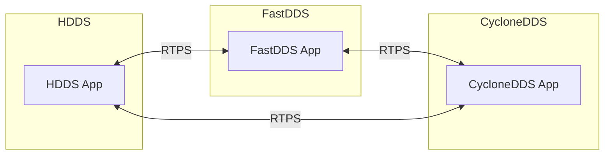
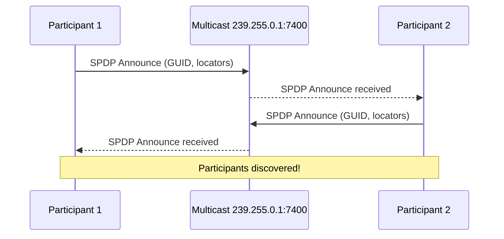
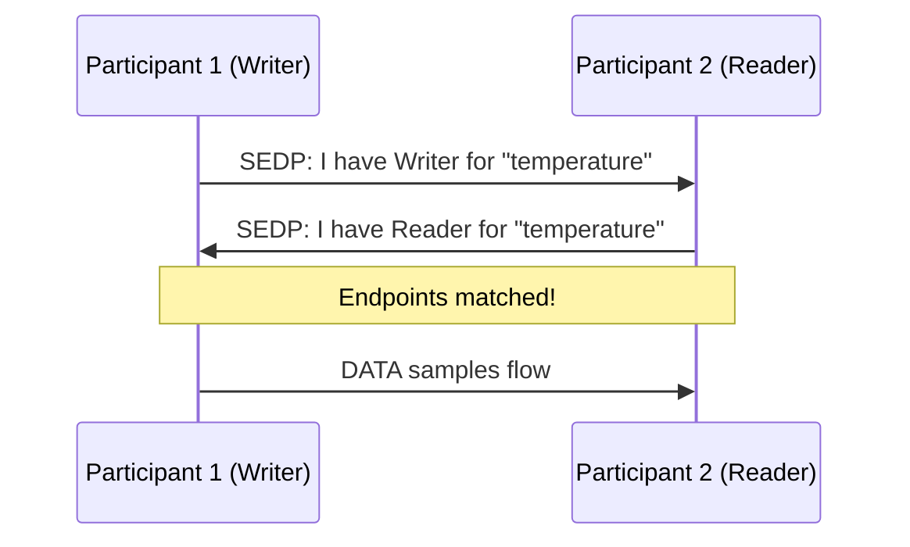
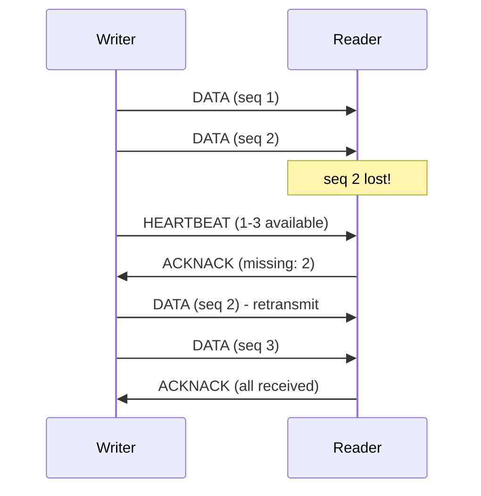

# What is RTPS?

**RTPS** (Real-Time Publish Subscribe) is the wire protocol that enables DDS implementations to communicate with each other. Defined by OMG, it specifies exactly how messages are formatted and exchanged over the network.

## Why RTPS Matters

RTPS is what makes DDS **interoperable**. Any compliant DDS implementation (HDDS, FastDDS, CycloneDDS, ...) can communicate if they speak the same RTPS version.



## RTPS Versions

| Version | Adopted by OMG |
|---------|----------------|
| **2.0** | April 2008 |
| **2.1** | November 2010 |
| **2.2** | September 2014 |
| **2.3** | May 2019 |
| **2.5** | April 2022 |

HDDS announces **RTPS 2.4** on the wire and accepts any 2.x peer; behaviour defined by later revisions of the specification (for example the KeyHash rules of 2.5) is implemented where it is needed for interoperability.

## Protocol Architecture

### Message Structure

Every RTPS message consists of:

```
+--------------------------------------------------------+
|                    RTPS Header                          |
|  +----------+----------+----------+-----------------+  |
|  | Protocol | Version  | Vendor   | GuidPrefix      |  |
|  | "RTPS"   | 2.4      | HDDS     | 12 bytes        |  |
|  +----------+----------+----------+-----------------+  |
+--------------------------------------------------------+
|                   Submessages                           |
|  +------------------------------------------------+    |
|  | Submessage 1 (e.g., DATA)                      |    |
|  +------------------------------------------------+    |
|  +------------------------------------------------+    |
|  | Submessage 2 (e.g., HEARTBEAT)                 |    |
|  +------------------------------------------------+    |
|  ...                                                    |
+--------------------------------------------------------+
```

### Submessage Types

| Submessage | Purpose |
|------------|---------|
| **DATA** | Carries user data samples |
| **DATA_FRAG** | Fragmented data for large samples |
| **HEARTBEAT** | Announces available sequence numbers |
| **ACKNACK** | Acknowledges/requests data |
| **GAP** | Indicates missing sequence numbers |
| **INFO_TS** | Provides timestamp information |
| **INFO_DST** | Specifies destination participant |
| **INFO_SRC** | Specifies source participant |

## Discovery Protocol

RTPS defines two discovery protocols:

### SPDP (Simple Participant Discovery Protocol)

Discovers other **participants** in the domain:

1. Each participant sends periodic announcements to a well-known multicast address
2. Announcements include participant GUID, endpoints, and locators
3. Other participants learn about new joiners



### SEDP (Simple Endpoint Discovery Protocol)

Discovers **endpoints** (writers and readers):

1. After participant discovery, endpoints are exchanged via unicast
2. Each participant learns about remote writers/readers
3. Matching (compatible QoS) writers and readers connect



## Port Mapping

RTPS uses a deterministic port mapping based on domain ID:

```
Discovery Multicast Port = 7400 + (250 x domainId)
Discovery Unicast Port   = 7410 + (250 x domainId) + (2 x participantId)
User Multicast Port      = 7401 + (250 x domainId)
User Unicast Port        = 7411 + (250 x domainId) + (2 x participantId)
```

**Example for Domain 0, Participant 0:**

| Port Type | Port Number |
|-----------|-------------|
| Discovery Multicast | 7400 |
| Discovery Unicast | 7410 |
| User Multicast | 7401 |
| User Unicast | 7411 |

:::warning Firewall Configuration
Each domain uses the 250 ports from `7400 + 250 x domainId`: ports 7400-7649 for
domain 0, 7650-7899 for domain 1, and so on. Open the range of every domain you
use.
:::

## Data Serialization (CDR)

RTPS uses **CDR2** (Common Data Representation) for serialization:

- **Platform-independent** - Works across different CPU architectures
- **Not self-describing** - Sender and receiver share the type definition (the IDL)
- **Efficient** - Minimal overhead compared to JSON/XML

```
XCDR2 little-endian body of the FINAL type
  struct Temperature { string sensor_id; float value; }
holding { sensor_id: "room1", value: 23.5 }   (16 bytes)

+------+------+------+------+------+------+------+------+
| 0x06 | 0x00 | 0x00 | 0x00 | 'r'  | 'o'  | 'o'  | 'm'  |
+------+------+------+------+------+------+------+------+
| '1'  | 0x00 | 0x00 | 0x00 | 0x00 | 0x00 | 0xBC | 0x41 |
+------+------+------+------+------+------+------+------+
  +--- string length 6 ---+  +- "room1" + NUL -+ +pad+ +- 23.5 as f32 (LE) -+
```

The bytes above are what a hddsgen-generated encoder writes for that type
(without the 4-byte encapsulation header that precedes a sample on the wire).
An `@appendable` type, the default, adds a 4-byte length header in front.

## Reliability Protocol

RTPS implements reliability through:

### Best-Effort

- Fire and forget
- No acknowledgments
- Lowest latency

### Reliable

- HEARTBEAT announces available samples
- ACKNACK requests missing samples
- Retransmission ensures delivery



## RTPS vs Other Protocols

| Feature | RTPS | MQTT | AMQP | ZeroMQ |
|---------|------|------|------|--------|
| **Broker** | None | Required | Required | Optional |
| **Multicast** | Yes | No | No | Yes |
| **QoS** | Rich (22 policies) | 3 levels | Basic | None |
| **Discovery** | Automatic | Manual | Manual | Manual |
| **Standard** | OMG | OASIS | OASIS | None |

## Debugging RTPS

### Using Wireshark

Wireshark has a built-in RTPS dissector:

1. Capture traffic on the UDP ports of your domain (7400-7649 for domain 0)
2. Filter: `rtps`
3. Inspect individual submessages

### Using hdds_viewer

The separate [hdds_viewer](https://viewer.hdds.io) tool provides:

- Replay of recorded capture files, with CDR2 payload decoding
- Topology visualization
- Timeline and latency analysis

## Next Steps

Now you understand how DDS works under the hood. Let's get HDDS installed:

- **[Installation Guide](../getting-started/installation/linux.md)** - Get HDDS on your system
