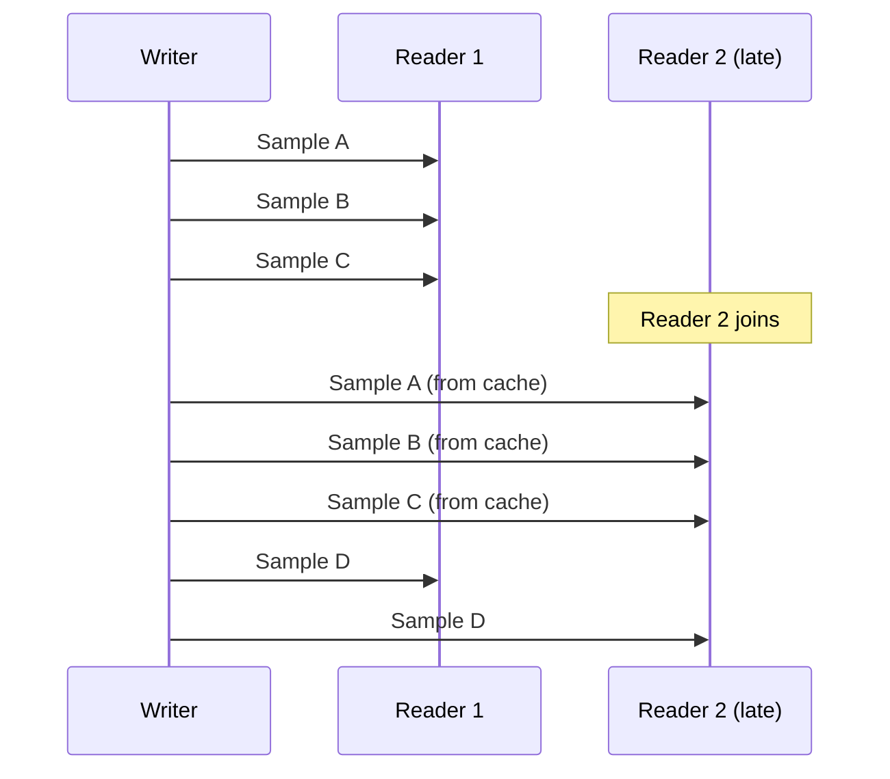

# Durability QoS Policy

The Durability policy controls whether samples are available to late-joining readers.

## Values

| Value | Description | Persistence |
|-------|-------------|-------------|
| `volatile()` | Samples only for connected readers | None |
| `transient_local()` | Writer caches samples for late joiners | In-memory, writer lifetime |
| `transient()` | Accepted; ranks between `transient_local()` and `persistent()` for matching | In-memory, writer lifetime |
| `persistent()` | Accepted; ranks highest for matching | In-memory, writer lifetime |

In the core runtime, `transient()` and `persistent()` keep their samples in the writer's memory, exactly like `transient_local()`; the writer's history is additionally sized by the [Durability Service](../../qos-guide.md) policy. Nothing is written to disk by the core. Disk-backed storage is provided by the separate `hdds-persistence` service (`crates/hdds-persistence`), which is not part of the core data path.

## Volatile (Default)

Samples are only delivered to readers that are connected when the sample is written.

```rust
use hdds::{Participant, QoS, TransportMode};

let participant = Participant::builder("streaming_app")
    .domain_id(0)
    .with_transport(TransportMode::UdpMulticast)
    .build()?;

let writer = participant
    .topic::<VideoFrame>("video/stream")?
    .writer()
    .qos(QoS::best_effort().volatile())
    .build()?;
```

**Use cases**:
- Real-time sensor data
- Video/audio streaming
- Data where history doesn't matter

## Transient Local

Writers cache samples in memory. Late-joining readers receive cached samples.

```rust
use hdds::{Participant, QoS, TransportMode};

let participant = Participant::builder("config_publisher")
    .domain_id(0)
    .with_transport(TransportMode::UdpMulticast)
    .build()?;

let writer = participant
    .topic::<Configuration>("system/config")?
    .writer()
    .qos(QoS::reliable().keep_last(100).transient_local())
    .build()?;

// Write some samples
writer.write(&config1)?;
writer.write(&config2)?;

// Later, a new reader joins and receives config1, config2
```

**Characteristics**:
- Samples persist as long as writer exists
- Cache size controlled by History policy
- Memory usage = history depth x sample size
- Lost when writer terminates

**Use cases**:
- Configuration/state topics
- Last-known-good values
- Initialization data

## Persistent

The strongest durability kind. Writers offering `persistent()` match readers requesting any durability kind. In the core runtime the samples are held in the writer's memory, like `transient_local()`, and do not survive a restart of the application. A disk-backed store for TRANSIENT and PERSISTENT topics is the separate `hdds-persistence` service.

```rust
use hdds::{Participant, QoS, TransportMode};

let participant = Participant::builder("event_logger")
    .domain_id(0)
    .with_transport(TransportMode::UdpMulticast)
    .build()?;

// Offers the strongest durability kind; keeps every sample
let writer = participant
    .topic::<AuditEvent>("audit/events")?
    .writer()
    .qos(QoS::reliable().keep_all().persistent())
    .build()?;
```

**Characteristics**:
- Matches readers requesting `volatile()`, `transient_local()`, `transient()` or `persistent()`
- Samples are cached in the writer's memory and are lost when the writer terminates
- Cache size is controlled by the History, ResourceLimits and Durability Service policies

**Use cases**:
- Topics whose data is also stored by a persistence service
- Interoperating with peers that request TRANSIENT or PERSISTENT durability

## Compatibility Rules

Durability has an ordered compatibility: writer must offer at least what reader requests.

| Writer | Reader | Match? |
|--------|--------|--------|
| persistent() | persistent() | Yes |
| persistent() | transient() | Yes |
| persistent() | transient_local() | Yes |
| persistent() | volatile() | Yes |
| transient() | persistent() | No |
| transient() | transient_local() | Yes |
| transient_local() | transient_local() | Yes |
| transient_local() | volatile() | Yes |
| transient_local() | transient() | No |
| transient_local() | persistent() | No |
| volatile() | volatile() | Yes |
| volatile() | transient_local() | No |
| volatile() | persistent() | No |

**Rule**: `Writer.durability >= Reader.durability`, with the order `volatile() < transient_local() < transient() < persistent()`.

## Late Joiner Behavior



## Memory Considerations

### Transient Local Memory Usage

```
Memory = history_depth x avg_sample_size x max_instances
```

Example:
- History depth: 100
- Sample size: 1 KB
- Instances: 10
- **Memory: 1 MB**

## Examples

### Configuration Topic

```rust
use hdds::{Participant, QoS, TransportMode};

let participant = Participant::builder("config_server")
    .domain_id(0)
    .with_transport(TransportMode::UdpMulticast)
    .build()?;

// Writer publishes configuration, late joiners get latest
let writer = participant
    .topic::<AppConfig>("system/config")?
    .writer()
    .qos(QoS::reliable().keep_last(1).transient_local())
    .build()?;

// Reader expects to receive current config on join
let reader = participant
    .topic::<AppConfig>("system/config")?
    .reader()
    .qos(QoS::reliable().transient_local())
    .build()?;
```

### Event Log

```rust
use hdds::{Participant, QoS, TransportMode};

let participant = Participant::builder("audit_logger")
    .domain_id(0)
    .with_transport(TransportMode::UdpMulticast)
    .build()?;

// Event log: keep every sample for late joiners (bounded by ResourceLimits)
let writer = participant
    .topic::<AuditEvent>("audit/events")?
    .writer()
    .qos(QoS::reliable().keep_all().transient_local())
    .build()?;
```

### Volatile Streaming

```rust
use hdds::{Participant, QoS, TransportMode};

let participant = Participant::builder("video_streamer")
    .domain_id(0)
    .with_transport(TransportMode::UdpMulticast)
    .build()?;

// Real-time video stream, no caching needed
let writer = participant
    .topic::<VideoFrame>("video/stream")?
    .writer()
    .qos(QoS::best_effort().keep_last(1).volatile())
    .build()?;
```

## Interaction with History

Durability and History work together:

| Durability | History | Cached Samples |
|------------|---------|----------------|
| volatile() | Any | 0 (no cache) |
| transient_local() | keep_last(N) | Last N samples |
| transient_local() | keep_all() | All samples (bounded by ResourceLimits) |
| transient() / persistent() | keep_last(N) | Last N per instance in the writer's memory (a larger Durability Service history depth raises it) |
| transient() / persistent() | keep_all() | All samples in the writer's memory (bounded by ResourceLimits) |

## Next Steps

- [History](../../guides/qos-policies/history.md) - Sample buffering configuration
- [Reliability](../../guides/qos-policies/reliability.md) - Delivery guarantees
