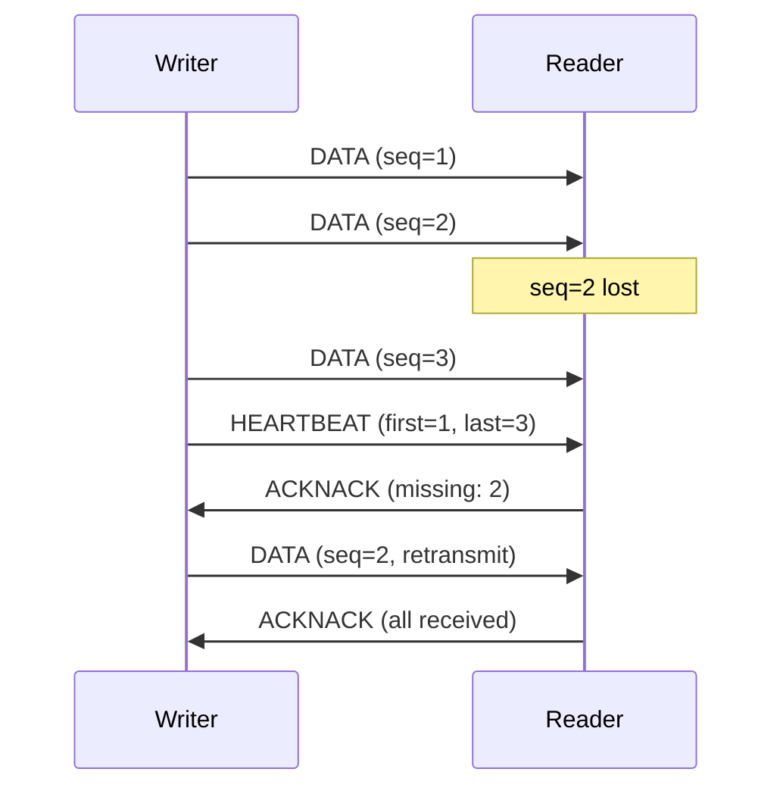

# Reliability QoS Policy

The Reliability policy controls whether data delivery is guaranteed or best-effort.

## Values

| Value | Description | Use Case |
|-------|-------------|----------|
| `best_effort()` | Fire and forget, no retransmission | Sensor data, video streaming |
| `reliable()` | Guaranteed delivery with ACK/NACK | Commands, state synchronization |

## Best Effort

Samples are sent once without acknowledgment. If a sample is lost due to network issues, it is not retransmitted.

```rust
use hdds::{Participant, QoS, TransportMode};

let participant = Participant::builder("sensor_app")
    .domain_id(0)
    .with_transport(TransportMode::UdpMulticast)
    .build()?;

let writer = participant
    .topic::<SensorData>("sensors/temperature")?
    .writer()
    .qos(QoS::best_effort())
    .build()?;
```

**Characteristics**:
- Lowest latency (no ACK overhead)
- No blocking on write
- Samples may be lost
- No memory accumulation for retransmission

## Reliable

Samples are acknowledged by readers. Lost samples trigger NACK-based retransmission.

```rust
use hdds::{Participant, QoS, TransportMode};

let participant = Participant::builder("command_app")
    .domain_id(0)
    .with_transport(TransportMode::UdpMulticast)
    .build()?;

let writer = participant
    .topic::<Command>("robot/commands")?
    .writer()
    .qos(QoS::reliable().keep_last(100))
    .build()?;
```

**Characteristics**:
- Guaranteed delivery (if reader is reachable)
- Higher latency due to ACK/NACK protocol
- Writer may block if reader is slow
- Memory used for retransmission buffer

## Protocol Details

### RTPS Reliable Protocol



### Heartbeat Mechanism

Writers periodically send HEARTBEAT messages announcing available sequence numbers. Readers respond with ACKNACK indicating which samples they need.

| Parameter | Default | Description |
|-----------|---------|-------------|
| Heartbeat period | 100 ms | Time between periodic heartbeats of a reliable writer |

## Compatibility Rules

Writers and readers must have compatible reliability settings:

| Writer | Reader | Match? |
|--------|--------|--------|
| RELIABLE | RELIABLE | Yes |
| RELIABLE | BEST_EFFORT | Yes |
| BEST_EFFORT | BEST_EFFORT | Yes |
| BEST_EFFORT | RELIABLE | **No Match** |

:::warning Incompatibility
A BEST_EFFORT writer cannot satisfy a RELIABLE reader. The reader expects acknowledgments that the writer won't send.
:::

## Performance Considerations

### Best Effort

```rust
use hdds::{Participant, QoS, TransportMode};

// High-frequency sensor data (1000+ Hz)
let writer = participant
    .topic::<SensorData>("sensors/imu")?
    .writer()
    .qos(QoS::best_effort().keep_last(1))
    .build()?;
```

Best-effort avoids retransmission state, but its latency and throughput still
depend on the transport, payload, topology, and machine.

### Reliable

```rust
use hdds::{Participant, QoS, TransportMode};

// Critical commands requiring guaranteed delivery
let writer = participant
    .topic::<Command>("robot/commands")?
    .writer()
    .qos(QoS::reliable().keep_last(100))
    .build()?;
```

Reliable delivery retains history and repair state. Memory scales with history
depth and sample size; latency and throughput require a deployment-specific
measurement.

### Large Message Fragmentation (>8KB)

HDDS automatically uses the RTPS DATA_FRAG mechanism when a serialized sample
exceeds 8192 bytes; the sample is then sent in 1024-byte fragments. Sustainable
rate depends on fragment size, repair traffic, loss, socket buffers, pacing, and
receiver capacity.

:::tip Best Practice
For high-volume large message streams (e.g., point clouds, video), measure loss
and repair behavior and apply rate limiting or flow control when the receiver
cannot sustain the offered load.
:::

```rust
// Example: LiDAR point cloud at 10 Hz (well within limits)
let writer = participant
    .topic::<PointCloud>("lidar/points")?  // ~100KB per sample
    .writer()
    .qos(QoS::reliable().keep_last(10))
    .build()?;

// Send at controlled rate
for cloud in lidar_stream {
    writer.write(&cloud)?;
    std::thread::sleep(Duration::from_millis(100));  // 10 Hz
}
```

## Blocking Behavior

With `reliable()`, the `write()` call may block until there is room in the writer's history or in a reliable reader's history. The wait is bounded by `max_blocking_time` (100 ms by default, set with `QoS::max_blocking_time(Duration)`); when it expires the sample is not published and `write()` returns `Error::WriteTimeout`:

```rust
use hdds::Error;

match writer.write(&sample) {
    Ok(()) => println!("Sample sent"),
    Err(Error::WriteTimeout) => println!("No room in time, sample not published"),
    Err(e) => return Err(e),
}
```

To avoid blocking:
1. Use larger history depth to buffer samples
2. Ensure readers keep up with writer rate

## Examples

### Telemetry (Best Effort)

```rust
use hdds::{Participant, QoS, TransportMode};

let participant = Participant::builder("telemetry")
    .domain_id(0)
    .with_transport(TransportMode::UdpMulticast)
    .build()?;

// High-rate sensor data where occasional loss is acceptable
let writer = participant
    .topic::<SensorData>("sensors/temperature")?
    .writer()
    .qos(QoS::best_effort().keep_last(1))
    .build()?;

let reader = participant
    .topic::<SensorData>("sensors/temperature")?
    .reader()
    .qos(QoS::best_effort())
    .build()?;
```

### Commands (Reliable)

```rust
use hdds::{Participant, QoS, TransportMode};

let participant = Participant::builder("robot_controller")
    .domain_id(0)
    .with_transport(TransportMode::UdpMulticast)
    .build()?;

// Robot commands that must not be lost
let writer = participant
    .topic::<Command>("robot/commands")?
    .writer()
    .qos(QoS::reliable().keep_all())
    .build()?;

let reader = participant
    .topic::<Command>("robot/commands")?
    .reader()
    .qos(QoS::reliable())
    .build()?;
```

### Mixed System

```rust
use hdds::{Participant, QoS, TransportMode};

let participant = Participant::builder("mixed_system")
    .domain_id(0)
    .with_transport(TransportMode::UdpMulticast)
    .build()?;

// Writer offers reliable (stronger guarantee)
let writer = participant
    .topic::<StateUpdate>("system/state")?
    .writer()
    .qos(QoS::reliable().keep_last(10))
    .build()?;

// Reader A accepts best-effort (compatible)
let reader_a = participant
    .topic::<StateUpdate>("system/state")?
    .reader()
    .qos(QoS::best_effort())
    .build()?;

// Reader B requires reliable (compatible)
let reader_b = participant
    .topic::<StateUpdate>("system/state")?
    .reader()
    .qos(QoS::reliable())
    .build()?;
```

## Next Steps

- [Durability](../../guides/qos-policies/durability.md) - Data persistence for late joiners
- [History](../../guides/qos-policies/history.md) - Sample buffering depth
