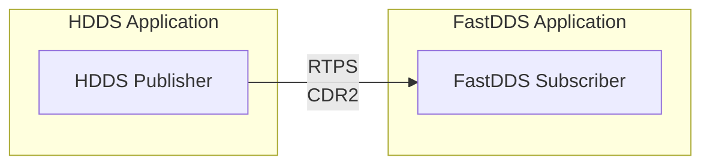

# Interoperability Guide

One of DDS's greatest strengths is **interoperability**. HDDS can communicate with other DDS implementations out of the box, thanks to the standardized RTPS wire protocol.

## Implementations

HDDS speaks standard RTPS. This page has setup guides for:

- eProsima Fast DDS
- Eclipse Cyclone DDS
- RTI Connext (with your own installation and licence; no results published here)

and, below, the results of a reproducible run against Cyclone DDS, Fast DDS and OpenDDS.

## Interoperability results

HDDS interoperates over plain RTPS/UDP with the open-source DDS implementations
listed below. The results come from a script in the HDDS repository,
[`scripts/interop-smoke/run-matrix.py`](https://git.hdds.io/hdds/hdds/src/branch/master/scripts/interop-smoke/run-matrix.py),
which anyone can rerun. They describe how HDDS interoperates with each
project; they are not a ranking, a score or a performance comparison. A cell
that does not pass is reported as "not passing yet" and treated as something
for HDDS to fix.

| Project | Version tested | License | Source |
|---------|----------------|---------|--------|
| Eclipse Cyclone DDS | 11.0.1 | EPL-2.0 OR BSD-3-Clause | [github.com/eclipse-cyclonedds/cyclonedds](https://github.com/eclipse-cyclonedds/cyclonedds) |
| eProsima Fast DDS | 3.6.2 | Apache-2.0 | [github.com/eProsima/Fast-DDS](https://github.com/eProsima/Fast-DDS) |
| OpenDDS | 3.34.0 | OpenDDS License (permissive, see the project's LICENSE file) | [github.com/OpenDDS/OpenDDS](https://github.com/OpenDDS/OpenDDS) |

Each cell is one direction and one reliability kind: one side publishes 100
samples of a small keyed type (`InteropPing`: a key, a sequence number and a
32-byte payload derived from a per-cell random challenge) on a topic unique to
the cell, and the other side subscribes. A cell is "interoperates" only if both
sides matched, neither timed out, the subscriber received exactly the samples
the publisher reported sending (none missing, none extra, every payload
checked), and a packet capture of the cell shows an endpoint of that project
and an HDDS endpoint exchanging data on that topic. Each entry below is the
number of valid samples received out of the number sent.

| Project | Direction | Reliability | Run 1 | Run 2 | Run 3 |
|---------|-----------|-------------|-------|-------|-------|
| Eclipse Cyclone DDS | HDDS publishes, peer subscribes | RELIABLE | interoperates (100/100) | interoperates (100/100) | interoperates (100/100) |
| Eclipse Cyclone DDS | HDDS publishes, peer subscribes | BEST_EFFORT | interoperates (100/100) | interoperates (100/100) | interoperates (100/100) |
| Eclipse Cyclone DDS | peer publishes, HDDS subscribes | RELIABLE | interoperates (100/100) | interoperates (100/100) | interoperates (100/100) |
| Eclipse Cyclone DDS | peer publishes, HDDS subscribes | BEST_EFFORT | interoperates (100/100) | interoperates (100/100) | interoperates (100/100) |
| eProsima Fast DDS | HDDS publishes, peer subscribes | RELIABLE | interoperates (100/100) | interoperates (100/100) | interoperates (100/100) |
| eProsima Fast DDS | HDDS publishes, peer subscribes | BEST_EFFORT | interoperates (100/100) | interoperates (100/100) | interoperates (100/100) |
| eProsima Fast DDS | peer publishes, HDDS subscribes | RELIABLE | interoperates (100/100) | interoperates (100/100) | interoperates (100/100) |
| eProsima Fast DDS | peer publishes, HDDS subscribes | BEST_EFFORT | interoperates (100/100) | interoperates (100/100) | interoperates (100/100) |
| OpenDDS | HDDS publishes, peer subscribes | RELIABLE | interoperates (100/100) | interoperates (100/100) | interoperates (100/100) |
| OpenDDS | HDDS publishes, peer subscribes | BEST_EFFORT | interoperates (100/100) | interoperates (100/100) | interoperates (100/100) |
| OpenDDS | peer publishes, HDDS subscribes | RELIABLE | interoperates (100/100) | interoperates (100/100) | interoperates (100/100) |
| OpenDDS | peer publishes, HDDS subscribes | BEST_EFFORT | interoperates (100/100) | interoperates (100/100) | interoperates (100/100) |

**36 of 36 cells interoperate** across the three runs (12 cells per run). All
three runs used no readiness pause between "matched" and the first write
(`--settle-ms 0`).

Provenance:

- HDDS: a clean 1.5.0 development build of the `interop_smoke` example. The
  harness is the same revision.
- Peers, each built from its project's own pinned release in a Docker image
  (the Dockerfiles are in the harness directory): Cyclone DDS 11.0.1, Fast DDS
  3.6.2, OpenDDS 3.34.0.
- Setup: one Linux host running Docker; HDDS native, the peer in a
  `--network host` container, discovery by ordinary RTPS multicast, one DDS
  domain per cell.

Scope: this exercises discovery and the delivery of one small type between
HDDS and each peer, with default QoS apart from the reliability kind. It does
not cover other QoS policies, large samples, security, other versions of
these projects, or other transports. RTI Connext is not part of this table.

To rerun it (Docker, `tcpdump` and the `pcap-diff` capture tool are required;
the README next to the script has the full setup):

```bash
cargo build --release --example interop_smoke -p hdds
cd scripts/interop-smoke
docker build -t hdds-interop-smoke-cyclonedds:11.0.1 -f vendors/cyclonedds/Dockerfile vendors/cyclonedds
docker build -t hdds-interop-smoke-fastdds:3.6.2     -f vendors/fastdds/Dockerfile     vendors/fastdds
docker build -t hdds-interop-smoke-opendds:3.34.0    -f vendors/opendds/Dockerfile    vendors/opendds
cd ../..
python3 scripts/interop-smoke/run-matrix.py \
    --hdds-bin target/release/examples/interop_smoke \
    --outdir /path/to/results --iface any --settle-ms 0
```

### Vendor IDs and protocol versions

Each implementation identifies itself in the RTPS header with a vendor ID
(DDS Foundation registry). The RTPS versions below are the ones the packet
captures of the runs above show in the message headers; read them again with
`tshark -r <capture>.pcap -Y rtps -T fields -e rtps.vendorId -e rtps.version.major -e rtps.version.minor`.

| Implementation | Vendor ID | RTPS version in message headers |
|----------------|-----------|---------------------------------|
| HDDS | 0x011A | 2.4 |
| Eclipse Cyclone DDS 11.0.1 | 0x0110 | 2.5 |
| eProsima Fast DDS 3.6.2 | 0x010F | 2.2 |
| OpenDDS 3.34.0 | 0x0103 | 2.4 |
| RTI Connext | 0x0101 | - |

## How Interoperability Works

All compliant DDS implementations use the **RTPS** (Real-Time Publish Subscribe) protocol for communication. This means:

1. **Automatic Discovery** - Participants find each other via SPDP multicast
2. **Wire Compatibility** - Data is serialized using CDR (XCDR1 or XCDR2, per the data representation and the type)
3. **QoS Negotiation** - Compatible QoS policies are matched automatically



## Quick Start

To communicate between HDDS and another DDS implementation:

1. **Use the same Domain ID** (e.g., domain 0)
2. **Use the same Topic name** (e.g., "sensor/temperature")
3. **Use compatible data types** (same structure, generated from same IDL)
4. **Use compatible QoS** (e.g., both RELIABLE or both BEST_EFFORT)

### Example: HDDS Publisher -> FastDDS Subscriber

**HDDS Publisher (Rust):**

```rust
use hdds::{Participant, TransportMode, DDS};

#[derive(Debug, Clone, DDS)]
struct Temperature {
    #[key]
    sensor_id: String,
    value: f32,
}

fn main() -> Result<(), hdds::Error> {
    let participant = Participant::builder("hdds_publisher")
        .domain_id(0)
        .with_transport(TransportMode::UdpMulticast)
        .build()?;
    let topic = participant.topic::<Temperature>("sensor/temp")?;
    let writer = topic.writer().build()?;

    writer.write(&Temperature { sensor_id: "s1".into(), value: 23.5 })?;
    Ok(())
}
```

A type written by hand with `#[derive(DDS)]` is only convenient inside HDDS.
For a type shared with another vendor, generate both sides from the same IDL
(`hddsgen gen rust Temperature.idl -o src/temperature.rs`, see
[FastDDS Interoperability](../interop/fastdds/setup.md#idl-type-definition)),
so the type name, the keys and the extensibility match.

**FastDDS Subscriber (C++):**

```cpp
auto participant = DomainParticipantFactory::get_instance()->create_participant(0, ...);
auto topic = participant->create_topic("sensor/temp", "Temperature", ...);
auto reader = subscriber->create_datareader(topic, ...);

// Will receive data from HDDS publisher
```

## Detailed Guides

- [FastDDS Interop](../interop/fastdds/setup.md) - Step-by-step FastDDS setup
- [RTI Connext Interop](../interop/rti-connext/setup.md) - RTI Connext setup with your own installation
- [CycloneDDS Interop](../interop/cyclonedds/setup.md) - Eclipse CycloneDDS setup
- [QoS Translation Matrix](../interop/qos-translation-matrix.md) - QoS mapping between vendors

## Common Issues

### Type Mismatch

Ensure both sides use the same IDL definition:

```idl
// Both HDDS and FastDDS should use this exact IDL
struct Temperature {
    @key string sensor_id;
    float value;
};
```

### QoS Incompatibility

QoS policies must be compatible for matching:

| Writer QoS | Reader QoS | Result |
|------------|------------|--------|
| RELIABLE | RELIABLE | Match |
| RELIABLE | BEST_EFFORT | Match |
| BEST_EFFORT | RELIABLE | **No Match** |
| BEST_EFFORT | BEST_EFFORT | Match |

### Discovery Issues

If participants don't discover each other:

1. Check firewall settings (UDP ports `7400 + 250 x D` to `7649 + 250 x D` for domain `D`)
2. Verify multicast is enabled
3. Check domain IDs match
4. Use `hdds_viewer` to debug traffic
