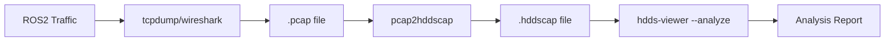

# Debugging ROS2 Traffic

HDDS Viewer - the observability tool of the HDDS suite, distributed separately from this repository - can capture, analyze, and debug ROS2 traffic.

> **Tooling note:** the `.hddscap` capture format and the `pcap2hddscap` / `hdds-viewer` tools shown below ship with HDDS Viewer, not with this core library. The core recording crate (`hdds-recording`) uses its own `.hdds` file format with MCAP export.

## Pipeline Overview



## Step 1: Capture ROS2 Traffic

On your ROS2 machine, capture RTPS/DDS traffic. The ports of a domain `D` are
`7400 + 250 x D` up to `7649 + 250 x D`; for domain 0:

```bash
sudo tcpdump -i any -w ros2_capture.pcap udp portrange 7400-7649
```

Run your ROS2 application while capturing. Let discovery complete (a few
seconds after the nodes start) and cover at least one full cycle of your
application.

### Capture Options

```bash
# Capture on a specific interface
sudo tcpdump -i eth0 -w ros2_capture.pcap udp portrange 7400-7649

# Limit the capture file size (100 MB)
sudo tcpdump -i any -w ros2_capture.pcap -C 100 udp portrange 7400-7649
```

## Step 2: Convert to HDDSCAP Format

```bash
pcap2hddscap ros2_capture.pcap ros2_capture.hddscap
```

The converter extracts the RTPS DATA submessages and writes them as
`.hddscap` frames, preserving timestamps and payloads. To print statistics
without converting:

```bash
pcap2hddscap --stats ros2_capture.pcap
```

## Step 3: Analysis

```bash
hdds-viewer --analyze ros2_capture.hddscap --format json
```

`--format` is one of `json`, `yaml` or `text`.

### Exit Code

`hdds-viewer --analyze` exits with a code that follows the highest severity
found:

| Code | Meaning |
|------|---------|
| 0 | No anomaly |
| 1 | Low severity |
| 2 | Medium severity |
| 3 | High severity |
| 4 | Critical severity, or the capture file could not be read |

## Interactive Analysis

To inspect a capture interactively, open it in the viewer:

```bash
hdds-viewer ros2_capture.hddscap
```

## Wireshark

The repository ships a Wireshark dissector for RTPS and HDDS traffic in
`tools/wireshark/` (see its README for installation). Filter on `rtps` in
Wireshark to see the RTPS traffic of a capture.

## Troubleshooting Common Issues

### No RTPS Packets Found

```bash
# Check which domain the nodes use
echo $ROS_DOMAIN_ID $HDDS_DOMAIN_ID

# Verify traffic exists
sudo tcpdump -i any udp portrange 7400-7649 -c 10
```

### Missing Topics

The capture might be too short. Ensure:
1. All ROS2 nodes are running during capture
2. The capture covers at least one full cycle of your application
3. Discovery has completed (wait a few seconds after node startup)

## Next Steps

- [hdds_viewer Documentation](https://viewer.hdds.io/docs) - Full tool documentation
- [ROS2 Performance Tuning](../ros2/performance.md) - Optimize based on findings
- [QoS Policies](../guides/qos-policies/overview.md) - Adjust QoS to fix issues
