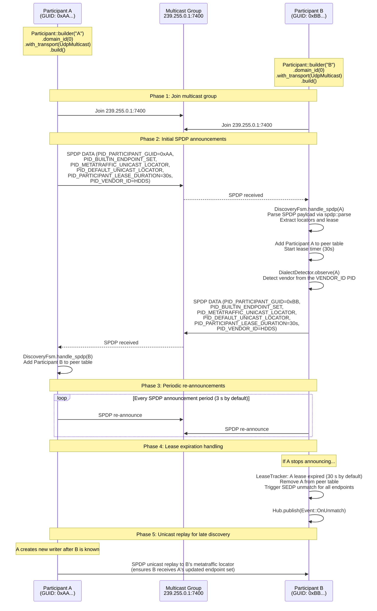
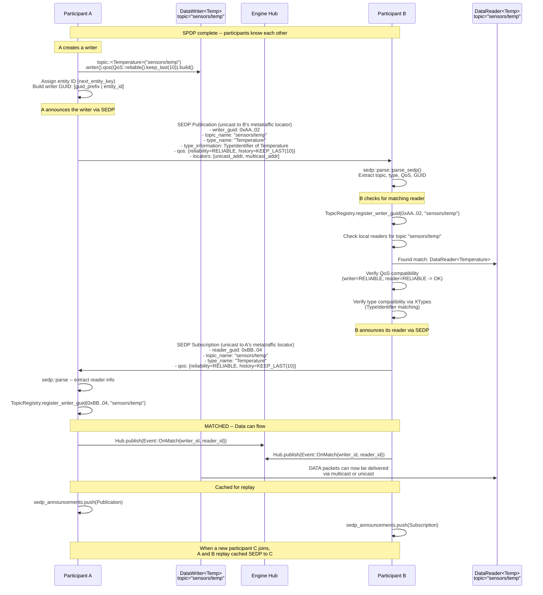
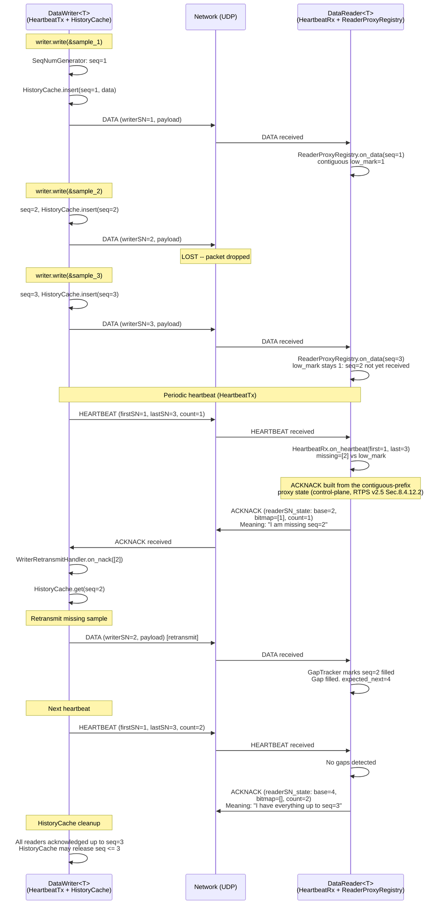
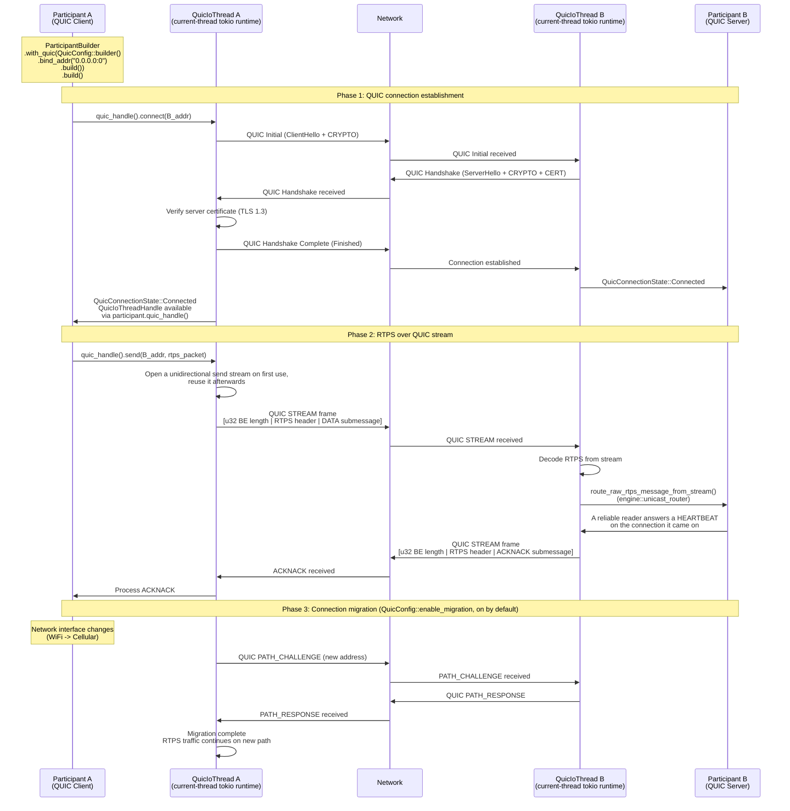
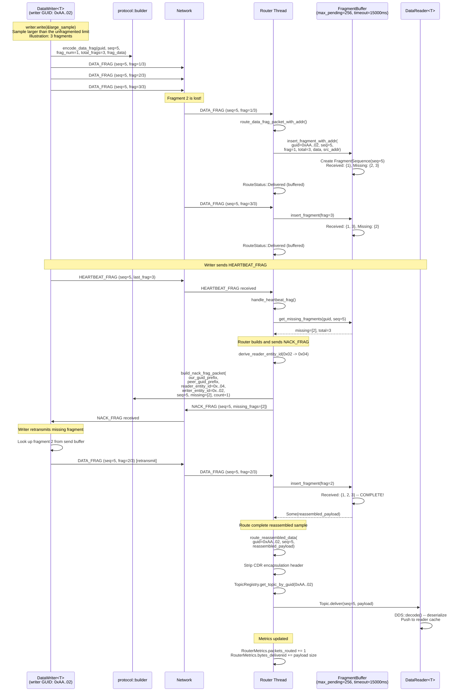
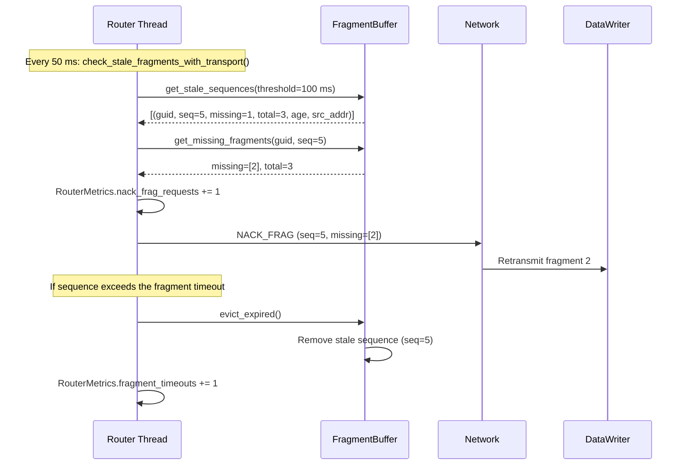
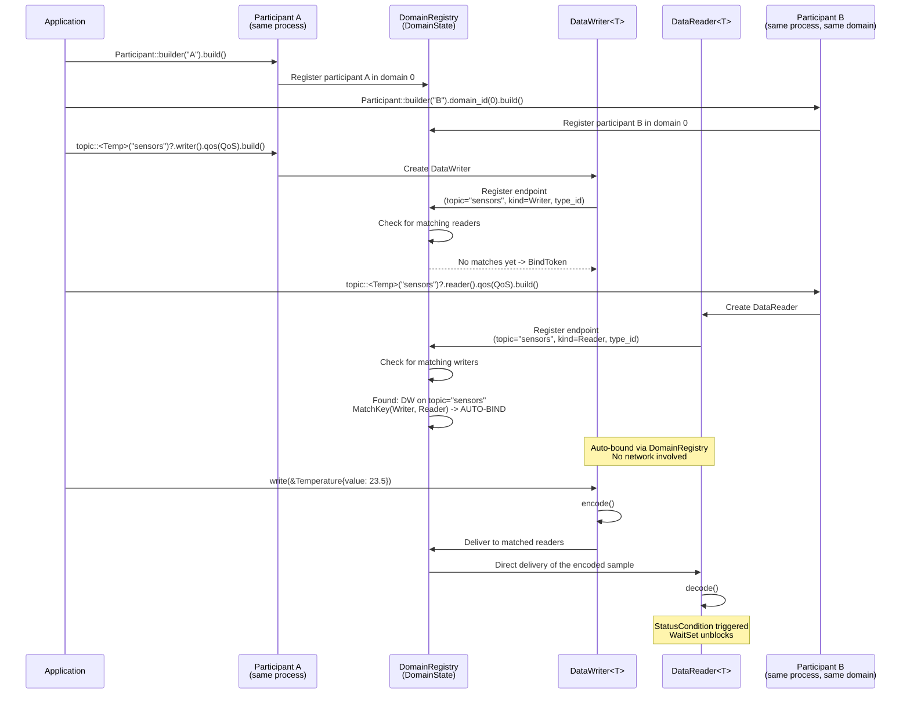
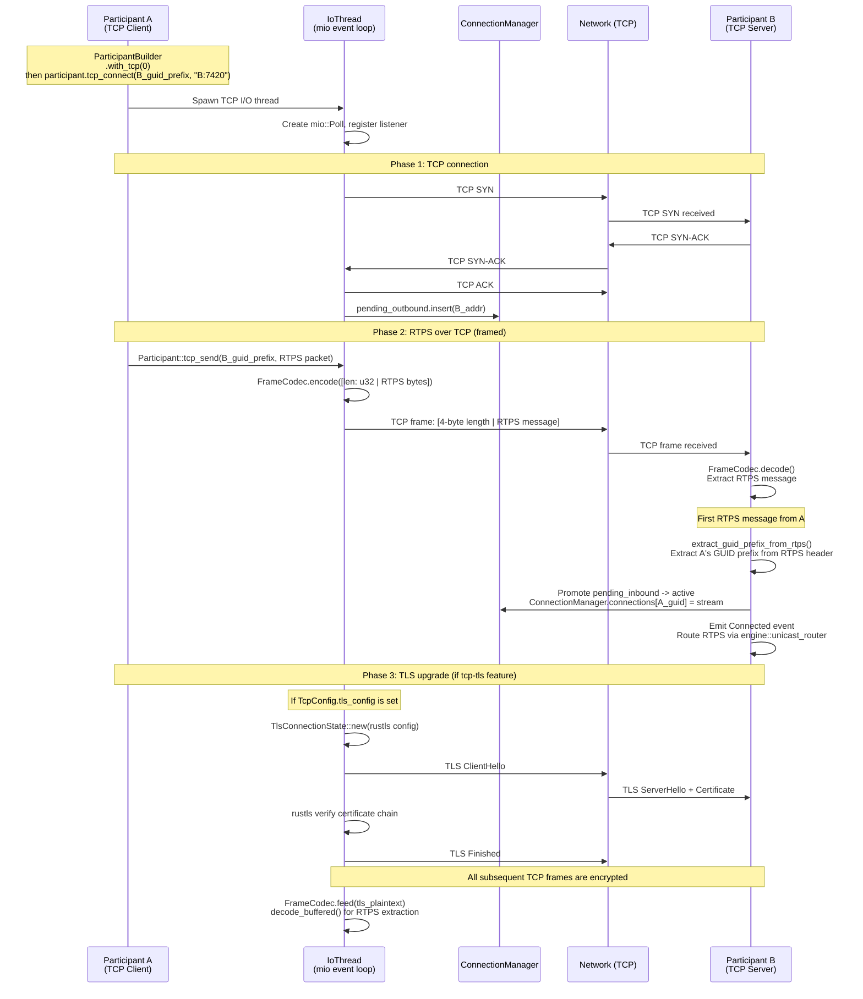

# HDDS Sequence Diagrams

Detailed Mermaid sequence diagrams for the core HDDS protocols.

---

## 1. Participant Discovery (SPDP)

The Simple Participant Discovery Protocol is the first phase of RTPS discovery.
All participants periodically multicast SPDP announcements to find each other.

Implementation: `crates/hdds/src/protocol/discovery/spdp/`



---

## 2. Endpoint Discovery (SEDP)

The Simple Endpoint Discovery Protocol follows SPDP. It announces DataWriter
and DataReader endpoints to enable topic matching.

Implementation: `crates/hdds/src/protocol/discovery/sedp/`



---

## 3. Reliable Data Exchange

The RTPS reliability protocol ensures all samples are delivered even with packet loss.

Implementation: `crates/hdds/src/reliability/`



---

## 4. QUIC Handshake + Data

HDDS exposes a manual QUIC handle with inbound RTPS routing, feature-gated
behind `quic`. `DataWriter::write` does not select it automatically; the send
shown below is the explicit `quic_handle().send` path.

Implementation: `crates/hdds/src/transport/quic/`



---

## 5. Security Handshake

DDS Security v1.1 authentication exchange between two participants.
Feature-gated behind the `security` feature flag.

Implementation: `crates/hdds/src/security/handshake/machine.rs` (state
machine), `crates/hdds/src/security/crypto/` (key derivation, distribution,
and the data-plane sealer)

```mermaid
sequenceDiagram
    participant A as Participant A<br/>(SecurityPluginSuite)
    participant AA as AuthenticationPlugin A<br/>(X.509 + ECDH)
    participant MC as Network
    participant AB as AuthenticationPlugin B<br/>(X.509 + ECDH)
    participant B as Participant B<br/>(SecurityPluginSuite)

    Note over A,B: Phase 0: SPDP with identity_token

    A->>MC: SPDP DATA + identity_token<br/>(X.509 certificate PEM,<br/> class_id="DDS:Auth:PKI-DH:1.0")
    MC->>B: SPDP received with identity_token
    B->>AB: validate_identity(A_cert_pem)
    AB->>AB: Parse X.509 certificate<br/>Verify CA chain (ca_certificates)<br/>Check expiration<br/>Check CRL (if revocation checking is configured)
    AB->>B: IdentityHandle(A) -- valid

    Note over A,B: Phase 1: Handshake Request<br/>(GUID order decides which side initiates; B here)

    B->>AB: begin_handshake(A_identity)
    AB->>AB: Generate ECDH keypair (dh1)
    AB->>AB: Generate challenge nonce (challenge1)
    B->>MC: AuthRequest token over the stateless message channel<br/>(class_id="DDS:Auth:PKI-DH:1.0+Req",<br/> c.id, c.perm, c.pdata, c.dsign_algo, c.kagree_algo,<br/> hash_c1, challenge1, dh1)
    MC->>A: AuthRequest received
    A->>AA: process_handshake(B_request)
    AA->>AA: Validate B certificate chain<br/>Check the request is not a replay
    AA->>AA: Generate ECDH keypair (dh2)<br/>Generate challenge nonce (challenge2)

    Note over A,B: Phase 2: Handshake Reply

    A->>MC: AuthReply token<br/>(class_id="DDS:Auth:PKI-DH:1.0+Reply",<br/> c.id, c.perm, c.pdata, hash_c2,<br/> challenge2, dh2, challenge1, dh1, hash_c1,<br/> signature)
    MC->>B: AuthReply received
    B->>AB: process_handshake(A_reply)
    AB->>AB: Validate A certificate<br/>Verify A's signature over the exchanged values<br/>Compute shared_secret = ECDH(dh1_priv, dh2)

    Note over A,B: Phase 3: Handshake Final

    B->>MC: AuthFinal token<br/>(class_id="DDS:Auth:PKI-DH:1.0+Final",<br/> hash_c1, challenge1, dh1, challenge2, dh2, hash_c2,<br/> signature)
    MC->>A: AuthFinal received
    A->>AA: process_handshake(B_final)
    AA->>AA: Verify B's signature<br/>Compute shared_secret = ECDH(dh2_priv, dh1)

    Note over A,B: Both sides now have the same shared_secret

    Note over A,B: Phase 4: Volatile-channel bootstrap material (both sides, independently)

    A->>AA: PeerKeys::new(shared secret, challenge1, challenge2)<br/>kept in HandshakeState::Complete<br/>PeerKeys::volatile_key_material() derives the KxKeys

    B->>AB: PeerKeys::new(shared secret, challenge1, challenge2)<br/>kept in HandshakeState::Complete<br/>same KxKeys derivation

    Note over A,B: Phase 5: Writer key distribution<br/>(per authenticated peer)

    A->>A: DatawriterCryptoTokens(writer GUID, key id, master key, salt)<br/>protected with peer KxKeys (AES-GCM)
    A->>MC: ParticipantVolatileMessageSecure protected DATA<br/>(builtin entities 0xff0202c3/c4)
    MC->>B: Key distribution received
    B->>B: Open with KxKeys for A<br/>install key and salt under (writer GUID, key id)

    Note over A,B: Phase 6: Secure data exchange

    A->>A: encode_serialized_payload(key_id, writer material, SerializedPayload)<br/>derived SessionKey, empty AES-GCM AAD
    A->>MC: DATA submessage, payload =<br/>CryptoHeader + CryptoContent + CryptoFooter<br/>(original CDR encapsulation encrypted)
    MC->>B: Secured DATA received
    B->>B: Read writer security attributes before choosing protection:<br/>look up (writer GUID, key id), decode_serialized_payload(),<br/>then original CDR version or DROP without sequence credit
    B->>B: Route decrypted data to reader

    Note over A,B: Audit logging (if enabled)
    A->>A: audit log records<br/>SecurityEvent::Authentication{B_guid, Success}
    B->>B: audit log records<br/>SecurityEvent::Authentication{A_guid, Success}
```

---

## 6. Fragmentation (DATA_FRAG)

Samples larger than the unfragmented limit (8192 bytes) are fragmented into multiple DATA_FRAG
submessages and reassembled on the reader side. HEARTBEAT_FRAG and NACK_FRAG
provide reliable fragment delivery.

Implementation:
- Sender: `crates/hdds/src/protocol/rtps/data.rs` (`encode_data_frag`)
- Receiver: `crates/hdds/src/engine/router.rs` (`route_data_frag_packet`)
- Fragment buffer: `crates/hdds/src/core/discovery/` (`FragmentBuffer`)
- NACK_FRAG: `crates/hdds/src/protocol/builder/nack_frag.rs`



### Timeout-Based NACK_FRAG (Backup Path)

If HEARTBEAT_FRAG is not received, the router's periodic stale-fragment check
provides a backup path for requesting retransmission.



---

## 7. Intra-Process Auto-Binding

When a writer and a reader in the same process and domain share a topic
and type, HDDS binds them through the `DomainRegistry` and delivers without
the network transport.

Implementation: `crates/hdds/src/dds/domain_registry.rs`



---

## 8. TCP Connection Lifecycle

The diagram describes the manual HDDS-to-HDDS `tcp_connect` / `tcp_send` path.
`DataWriter::write` remains UDP-only; configuring `TransportPreference` does
not select this path automatically.

Implementation: `crates/hdds/src/transport/tcp/`


